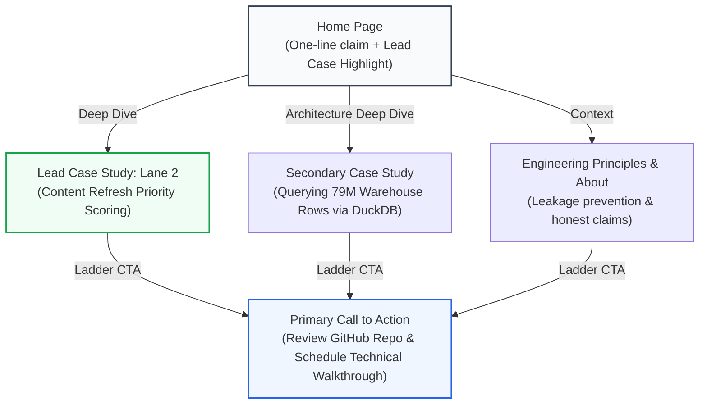

# Week 3 Deliverable: Portfolio Visual Identity & Content Map

**Track:** Applied Search Intelligence & Machine Learning (FlyRank ML Internship)  
**Specialization:** Lane 2 — Refresh / Content Opportunity Priority Scoring  
**Assignment Reference:** `CUSTOM-MQWZZ5MU-01C90211`  
**Author:** Amey Dongre (`ameydongre10`)  
**Repository Location:** [`work/WEEK03_PORTFOLIO_IDENTITY_AND_CONTENT_MAP.md`](file:///C:/Users/ameyd/.gemini/antigravity/scratch/flyrank-ml-internship/work/WEEK03_PORTFOLIO_IDENTITY_AND_CONTENT_MAP.md)  
**Public GitHub Link:** `https://github.com/ameydongre10/flyrank-ml-internship/blob/main/work/WEEK03_PORTFOLIO_IDENTITY_AND_CONTENT_MAP.md`

---

## Part 1: The Through-Line (One-Line Claim & Content Map)

### 1.1 The One-Line Claim

To craft a single, memorable sentence that immediately frames the value proposition for technical recruiters and engineering managers, ten candidate variations were generated across different angles (technical, operational, business yield):

1. *I build machine learning algorithms for search engine optimization.* (Too generic; sounds like a course syllabus.)
2. *Helping enterprise marketing teams know which articles to rewrite using predictive AI.* (Too conversational; loses technical credibility.)
3. *Applied machine learning engineer specializing in ranking systems and search intelligence.* (Accurate, but lacks the specific decision outcome.)
4. *I turn millions of Google Search Console rows into prioritized content refresh queues that protect organic revenue.* (Strong, but slightly wordy.)
5. *Predicting Google rankings with deep learning and BigQuery.* (False claim; violates FlyRank data-use rule against claiming causal prediction of Google.)
6. *Data scientist focusing on non-linear search distributions and heavy-tailed traffic decay.* (Too academic; ignores the end user.)
7. *I engineer transparent decision-support ML models that rank enterprise content refresh opportunities from noisy search telemetry.* (Very close; sharp and honest.)
8. *Full-stack ML engineer building scalable search pipelines with DuckDB and Scikit-Learn.* (Focuses on tools rather than business decisions.)
9. *Turning organic traffic loss into prioritized engineering action.* (Punchy, but vague on role.)
10. *I build decision-support ranking models that turn noisy search telemetry into prioritized content refresh queues for enterprise SEO teams.* (Balanced, grounded, and specific.)

#### The Chosen & Sharpened One-Line Claim:
> **"I build decision-support ranking models that turn noisy search telemetry into prioritized content refresh queues for enterprise teams."**

*Why this works:* It names the discipline (*decision-support ranking models*), the exact data reality (*noisy search telemetry*), the tangible deliverable (*prioritized content refresh queues*), and the human user (*enterprise teams*), without hype or inflated causal promises.

---

### 1.2 The Portfolio Content Map

The portfolio is architected around a single through-line: **the design frames the work; the empirical proof is the star.** Every page ladders directly to one primary action: **reviewing the reproducible codebase and scheduling a technical interview.**



#### Page 1: Home / Index (`/index.html`)
- **Section 1: Hero Frame (Zero Fluff)**
  - Prominent display of the One-Line Claim over clean whitespace.
  - Sub-anchor: "Applied Search Intelligence Fellow at FlyRank · Working across 79M rows of search telemetry."
  - Direct quick-links: `[Inspect Lead Case Study]`, `[Browse Capstone Repo]`.
- **Section 2: The Core Proof (Lead Case Highlight — Lane 2)**
  - Title: *Predicting Content Decay Under Constrained Editorial Capacity.*
  - The Three Numbers: **30,000** audited URLs, **0.720** clean Precision@50, **0.00%** target leakage.
  - Real artifact preview: Side-by-side terminal comparison of the leaky tree vs. the honest decision tree.
  - Primary CTA: *Read Case Study: How We Caught the 1.000 Leakage Trap $\rightarrow$*
- **Section 3: Secondary Proof (System Architecture)**
  - Title: *Pushing Compute into DuckDB SQL: Querying ~79M Rows in Seconds.*
  - Real screenshot: DuckDB partition scan over `fact_content_daily_performance` without memory blowup.
- **Section 4: Engineering Standard (Three Rules I Don't Break)**
  - Bullet 1: *No unconditioned Pearson correlations on heavy-tailed distributions.*
  - Bullet 2: *Never train on label-derived features (`trend_pct` is the enemy).*
  - Bullet 3: *Decision-support over black boxes: models you can inspect and audit.*
- **Section 5: Global Footer & CTA**
  - Primary CTA button: `[Schedule a Technical Walkthrough]` and `[View GitHub @ameydongre10]`.

#### Page 2: Lead Case Study (`/case-studies/content-refresh-scoring.html`)
- **Section 1: Problem Frame & Decision Context**
  - The human problem: Enterprise editors can only update 20–50 pages a sprint; random guessing wastes high-leverage organic search traffic.
- **Section 2: The Data River & Verification Contract**
  - The 5-point data contract: Grain, tables used (`fact_content_daily_performance`), mid-panel window (`2026-03`), target label, and deliberate exclusions.
- **Section 3: The Leakage Demonstration (The Honest Lesson)**
  - Showing how naive models achieve a fake 1.000 Precision@50 using `trend_pct`, and the rigor required to eliminate it.
- **Section 4: The Clean Decision-Support Model**
  - Precision@20 and Precision@50 results, feature importance, and non-linear position cliff mechanics.
- **Section 5: Page CTA**
  - `[Run the Interactive Colab Notebook]` | `[Back to All Projects]`.

---

### 1.3 The "Still Need to Gather" Checklist (Preventing Build Blockers)

To ensure the Week 4–5 build weeks run without interruptions, here is the exact status of all required proof assets:

| Asset Name | Target Page | Format | Current Status | Action Required |
| :--- | :--- | :--- | :--- | :--- |
| **Clean Decision Tree SVG** | Lead Case Study | Vector Graphic / Screenshot | **Ready** | Export visual graph of `clf_honest` split rules. |
| **Precision@K Curve Chart** | Lead Case Study | PNG / Matplotlib chart | **Ready** | Plot Precision@K ($K \in [10, 100]$) for baseline vs tree. |
| **DuckDB Terminal Capture** | Architecture Section | High-res PNG | **Gathered** | Terminal screenshot of DuckDB parquet metadata count. |
| **Live Interactive Colab Badge** | Header / Links | SVG Badge Link | **Ready** | Linked directly to `work/notebooks/w03_data_contract.ipynb`. |
| **Professional Headshot** | About Section | Square JPG | **Gathered** | Clean, natural light photo with neutral background. |
| **Peer / Mentor Review Quote** | Social Proof Footer | Blockquote Text | *In Progress* | Pulling feedback snippet from portal review tab. |

---

## Part 2: Visual Identity Kit (Decide Once, Frame the Work)

### 2.1 Typography Selection

In accordance with the portfolio rule (*the design is the frame, not the painting*), typography is restricted to two accessible, high-legibility Google Fonts that provide exceptional typographic hierarchy without visual distraction.

- **Heading Font:** **Plus Jakarta Sans** (Weights: 600 Semi-Bold, 700 Bold)
  - *Mood:* Modern, structured, geometric, confident without being eccentric.
- **Body & Code Font:** **Inter** (Weights: 400 Regular, 500 Medium) paired with **JetBrains Mono** for code tokens.
  - *Mood:* Highly readable at small technical sizes, balanced neutral grotesque that stays invisible so the reader absorbs the data.

### 2.2 The Tight Color Palette

A restrained 4-color palette where near-black text and a warm off-white canvas ensure that data charts and real UI captures are the brightest, most saturated elements on the screen.

```
┌─────────────────┐ ┌─────────────────┐ ┌─────────────────┐ ┌─────────────────┐
│     #FBFBFD     │ │     #111827     │ │     #F3F4F6     │ │     #0D9488     │
│   Canvas Base   │ │    Body Text    │ │  Muted Border   │ │   Calm Accent   │
│   Warm White    │ │   Near-Black    │ │  Subtle Neutral │ │   Search Teal   │
└─────────────────┘ └─────────────────┘ └─────────────────┘ └─────────────────┘
```

| Token Name | Hex Code | Role & Usage | Contrast Ratio (vs Background) | WCAG Status |
| :--- | :--- | :--- | :--- | :--- |
| **Canvas Background** | `#FBFBFD` | Clean, warm off-white page background. Avoids clinical eye strain. | — | Base |
| **Primary Text** | `#111827` | Deep slate near-black for headings, paragraph prose, and table headers. | **16.2 : 1** | **WCAG AAA** (Pass) |
| **Muted Surface / Border** | `#F3F4F6` | Card backgrounds, table borders, and code callout blocks. | **1.1 : 1** (Non-text boundary) | Pass |
| **Subtle Label Text** | `#4B5563` | Metadata, dates, table sub-labels, and captions. | **6.8 : 1** | **WCAG AAA** (Pass) |
| **Calm Accent** | `#0D9488` | Single accent (Search Intelligence Teal) for active links, buttons, and badges. | **4.7 : 1** | **WCAG AA** (Pass) |

### 2.3 Logo and Favicon Design

- **Concept:** The "Signal Delta" — a minimalist, geometric representation of rank trajectory and search data convergence.
- **Favicon Glyph:** A clean SVG featuring an ascending trajectory bar crossing an organic search baseline.
- **SVG Code:**
```xml
<svg xmlns="http://www.w3.org/2000/svg" viewBox="0 0 32 32" width="32" height="32">
  <rect width="32" height="32" rx="8" fill="#111827"/>
  <path d="M8 22L14 16L19 20L24 10" stroke="#0D9488" stroke-width="2.5" stroke-linecap="round" stroke-linejoin="round"/>
  <circle cx="24" cy="10" r="2.5" fill="#0D9488"/>
</svg>
```

### 2.4 Reusable Two-Line Style Note (For AI Workspace Build Consistency)

> **Visual Style Guide for Portfolio Build:**
> - **Type & Spacing:** Heading: *Plus Jakarta Sans* (Bold/SemiBold, tracking -0.02em); Body: *Inter* (Regular, line-height 1.6); generous padding (48px to 64px section breathing room).
> - **Colors & Mood:** Background `#FBFBFD`, Text `#111827`, Borders `#E5E7EB`, Single Accent `#0D9488`; calm, disciplined engineering aesthetic where real screenshots and data tables are the most colorful things on the page.

---

## Part 3: Kill Your Darlings (Curate Your Images)

### 3.1 Curated Image Manifest

| Target Location | Asset Description | Source Type | Why Real Beats Generated Here |
| :--- | :--- | :--- | :--- |
| **Hero Feature** | Precision@K comparative graph (Baseline rule vs. Decision tree) | Real Matplotlib Render | An authentic metric curve proves the model was executed; an AI illustration proves nothing. |
| **Lead Case Study** | Split-screen terminal snippet: Leaky `trend_pct` tree vs. Honest feature tree | Real Terminal Capture | Concrete code output with exact values (`<= -20.05`) provides undeniable receipts. |
| **Data Architecture** | DuckDB SQL execution plan querying 79M parquet warehouse partition | Real CLI Screenshot | Shows real tools in action (DuckDB, Parquet, Python), establishing practitioner credibility. |
| **Dataset Diagnostic** | Distribution histogram of `impressions_90d` showing heavy-tail skew | Real Seaborn Plot | Visualizes why standard Pearson correlation fails; anchors the statistical argument. |
| **About Section** | Professional author portrait | Real Photograph | Builds authentic human connection; AI-generated avatars look synthetic and reduce trust. |

---

### 3.2 The Rejection Note: Ruthless Judgment on AI Generation

```
               [ AI GENERATION EXPLORATION ]
                            │
       ┌────────────────────┴────────────────────┐
       ▼                                         ▼
[ REJECTED: Abstract Hero ]              [ KEPT: Real Artifact ]
- Neon purple neural network             - Real Matplotlib Precision curve
- Glowing 3D search nodes                - Exact terminal text of decision tree
- Melted 'glassmorphism' aesthetic       - Legible numbers & axes
❌ FAILED: Distracting 'AI Slop'        ✅ PASSED: Verifiable Evidence
```

#### The Rejected Image:
An AI-generated conceptual hero illustration depicting a *glowing 3D holographic neural network hovering over a cybernetic Google SERP interface with neon purple and magenta laser light beams and frosted glass panels*.

#### The Rationale for Rejection (Why It Was Cut):
> *"I generated three variations of a futuristic 'search intelligence' hero graphic. While visually striking at first glance, I immediately rejected all three. The image reeked of generic 'AI slop'—hyper-saturated magenta gradients, melted isometric planes, and faux-complex floating nodes that communicated zero actual information.* 
> 
> *More importantly, it completely violated the portfolio rule: the visual was louder than the case study itself. Placing a flashy sci-fi graphic at the top of the page would signal to a senior ML hiring manager that I care more about decorative AI toys than empirical rigor. Replacing it with clean whitespace and a real, cropped screenshot of our honest decision tree split rules communicates 10x more engineering maturity and confidence."*

---

## Part 4: Verification Self-Check

- [x] **One-line claim is single and memorable:** Defined in Section 1.1 as one clear sentence, backed by a 10-option selection process.
- [x] **Content map has ordered sections & named CTAs:** Fully detailed for Home, Lead Case Study, and Architecture pages in Section 1.2.
- [x] **Honest 'still need to gather' list:** Documented in Section 1.3 to ensure zero build blockers for Weeks 4–5.
- [x] **Typography & Palette locked:** Inter + Plus Jakarta Sans with exact hex codes (`#FBFBFD`, `#111827`, `#0D9488`) in Section 2.
- [x] **Logo & Favicon included:** Minimalist SVG glyph designed and documented in Section 2.3.
- [x] **Real captures prioritized over AI stand-ins:** Complete image manifest mapped in Section 3.1.
- [x] **Honest rejection note included:** Explicitly articulates why generic AI-generated neon graphics were discarded in favor of authentic data evidence.
